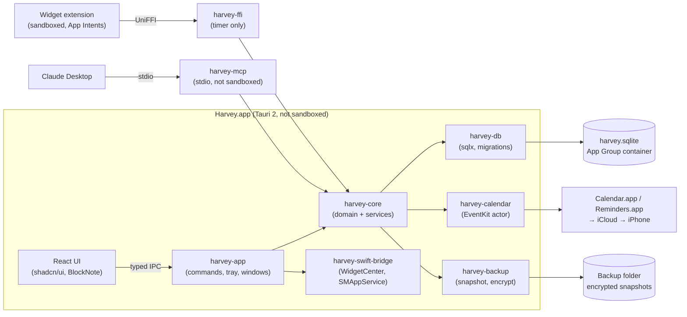
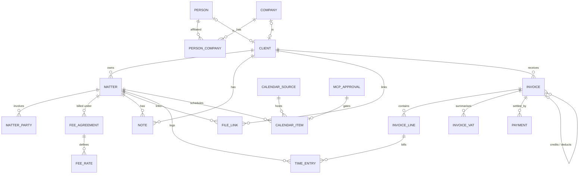

# Harvey — v1 Specification

| | |
| --- | --- |
| **Status** | Draft v0.2 (after multi-angle review) |
| **Date** | 2026-11-27 |
| **Audience** | Developers, product owner, end user |
| **Product language** | UI in French · this document in English |

## Revision history

| Version | Changes |
| --- | --- |
| 0.1 | Initial draft. |
| 0.2 | Review pass (technical feasibility, French legal/billing, consistency/testability, security/privacy). Main changes: explicit process & sandbox model (§6.8); EventKit only in the app + login item; shared-DB rules (single migrator, `BEGIN IMMEDIATE`, maintenance lock, online-backup restore); **encrypted backups**; guarded MCP (off by default, read-only by default, approval queue, exclusion flag); calendar privacy defaults; semantic statuses; invoice rules (gapless series, immutable snapshot, credit notes, advance invoices for provisions, débours/frais/droit de plaidoirie, VAT treatments, e-invoicing readiness); timezone/date conventions; timer model; IPC/CSP/URL-scheme hardening; custom release pipeline; macOS e2e; CI secret isolation; milestone re-ordering. |

---

## 1. Overview

### 1.1 Problem

The target user is an independent lawyer (*avocat·e*) practising in France. Their day-to-day work is spread across Calendar.app, Reminders.app, spreadsheets, folders in Finder and paper notes. They need a single, private tool on their MacBook to follow their clients and prospects, their matters (*dossiers*), the time spent on them and what has been billed and paid — and to push hearings, appointments and deadlines into the calendar already used on all their devices.

### 1.2 Product vision

**Harvey** is a local-first macOS desktop application for a solo legal practice:

- all data lives on the user's Mac, works offline, no cloud account required;
- the calendar stays Apple's: Harvey writes into Calendar.app / Reminders.app via EventKit, so iCloud keeps the iPhone in sync — with privacy-minimal titles by default;
- a timer is always one click away (desktop widget + menu bar);
- Claude Desktop can work on the data through an **MCP connector** that is opt-in, read-only by default and guarded for writes.

### 1.3 v1 goals

1. Manage persons, companies, clients and prospects, and the links between them.
2. Manage matters with a configurable reference numbering.
3. Capture long-form notes with a Notion-like editor everywhere.
4. Link existing files on disk to clients and matters.
5. Create and maintain events and reminders in the calendars/lists the user chooses.
6. Track time (timer + manual) and billing (fee agreements, provisions, invoices, payments) in line with French invoicing rules, ready for the 2027 e-invoicing obligation.
7. Back up the database automatically, **encrypted**, into a folder the user chooses (typically iCloud Drive).
8. Expose the data to Claude Desktop through a guarded MCP server.
9. Look and feel like a polished, branded native Mac app (own brand, Tahoe-compliant icon).

### 1.4 Non-goals for v1 — and the extension point that keeps each cheap later

| Not in v1 | Why it stays easy later |
| --- | --- |
| Mobile app | All logic in `harvey-core` (no Tauri dependency); an HTTP API can wrap the same services. Calendar already syncs to iPhone via iCloud. |
| Email integration (Mail.app, IMAP) | `note` already supports an email type and file links; an ingester can call `harvey-core`. |
| Multi-user | `user` table + `created_by`/`updated_by` on every row from day one; UUIDv7 keys; `change_log` table. |
| Integrated document management (GED) | File links are an isolated module (`file_link`) that a GED can replace or extend. |
| Encryption of the **live** database | One connection factory, ready for SQLCipher. FileVault protects the live DB in v1. (Backups *are* encrypted in v1.) |
| Issuing e-invoices (Factur-X / platform submission) | Invoice model stores everything required (§3.10.4); a Factur-X generator and platform connector can be added before 1 Sept 2027. |
| Client-funds (CARPA *maniements de fonds*) ledger | Not tracked in v1; fee balances never include client funds. A separate ledger can be added. |
| Data import | Not required. CSV/JSON *export* is provided. |
| Automated retention / purge | No purge in v1. Dates needed by future rules (`closed_at`, last activity, issue dates) are stored. See open question on retention alerts. |
| Compliance modules pending decision | AML (LCB-FT) vigilance, GDPR retention alerts, conflict-check support, legal-aid/insurer funding — see §15. |

---

## 2. Glossary

| Term (spec) | UI label (FR) | Definition |
| --- | --- | --- |
| Person | Personne | A natural person. |
| Company | Société | A legal entity (SIREN, legal form…). |
| Affiliation | Rattachement | Link between a person and a company with a role (gérant, salarié, représentant légal…). |
| Client | Client | A person **or** a company the lawyer works for. |
| Prospect | Prospect | A potential client; same record as a client at an earlier *stage*. |
| Matter | Dossier | A case or engagement for a client. |
| Party | Partie | A person/company involved in a matter with a role (partie adverse, avocat adverse, juridiction…). |
| Note | Note | Dated rich-text entry (note, call, meeting, email…) on a client and/or matter. |
| File link | Fichier lié | Reference to an existing file or folder on disk. |
| Time entry | Temps | A duration of work on a matter, billable or not. |
| Timer | Chronomètre | The single running time entry. |
| Fee agreement | Convention d'honoraires | Written billing terms of a matter (mandatory, art. 10 loi 1971). |
| Provision | Provision | An advance on fees; invoiced as an **advance invoice** (*facture d'acompte*), VAT due on receipt. |
| Invoice | Facture | A bill issued to a client (tracked in Harvey). |
| Credit note | Avoir | Negative invoice cancelling all or part of an issued invoice. |
| Payment | Règlement | Money received against an invoice. |
| Disbursement | Débours | Cost paid in the client's name and on their behalf, outside the VAT base (art. 267 II-2° CGI). |
| Expense | Frais | Cost re-invoiced as part of the fee, subject to VAT. |
| Event | Rendez-vous / Audience / Échéance | A Calendar.app event created by Harvey. |
| Reminder | Rappel | A Reminders.app item created by Harvey. |
| Reference list | Liste de référence | User-editable list of values (statuses, practice areas, roles…). |
| Semantic | Sens | Fixed system meaning behind a status value (e.g. invoice `issued`), which business rules rely on. |

---

## 3. Functional requirements

Priorities: **M** = must (v1), **S** = should (v1 if time allows), **C** = could (later). IDs are stable identifiers; gaps and out-of-order IDs are intentional after revisions.

### 3.1 Contacts — persons, companies, clients, prospects

| ID | Pri | Requirement |
| --- | --- | --- |
| FR-01 | M | Create, edit, archive and restore **persons** (civility, first/last name, profession, emails, phones, postal addresses, rich-text notes). Birth date, birth place and nationality are **optional fields**, hidden until enabled (data minimisation). |
| FR-02 | M | Create, edit, archive and restore **companies** (name, legal form, SIREN/SIRET, VAT number, registered address, website, rich-text notes). |
| FR-03 | M | Link a company to **one or many persons** with a role and optional start/end dates; a person may be affiliated with several companies. Both sides show the links. |
| FR-04 | M | Make a person **or** a company a **prospect** or a **client**. At most one client record per person and per company (unique constraint). |
| FR-05 | M | Prospects have a prospect status (semantic `open`/`converted`/`lost`), a source, first-contact date and expected practice area. |
| FR-06 | M | **Convert** a prospect into a client in one action: stage → client, prospect status → the `converted` value, client status → client default, `converted_at` set; all notes, events, file links and history kept. Converting an existing client returns `Conflict` (MCP: idempotent no-op). Dropping a kanban card on a `converted` column calls the conversion. A client cannot go back to prospect. |
| FR-07 | M | Lists of clients, prospects, persons and companies with sorting, filters (status, practice area, archived) and quick search. "Last activity" = most recent of note date, time entry date, calendar item date, invoice date. |
| FR-08 | M | Archive = soft delete (hidden by default, restorable, excluded from widget and MCP unless asked). Archiving a client offers to archive its open matters, stops a running timer on them and unpins them. Hard delete only for records with no linked data, with confirmation; it also redacts that entity's `change_log` diffs. Mentions of a deleted entity render as "élément supprimé". |
| FR-09 | S | Duplicate detection on creation (same name + email/phone/SIREN). |
| FR-19 | M | Client billing profile: **professional vs consumer** flag, billing name/address, SIREN and VAT number (required for professional clients — needed for invoice mentions and e-invoicing). |

### 3.2 Configurable reference lists

| ID | Pri | Requirement |
| --- | --- | --- |
| FR-10 | M | On first start, Harvey seeds **French defaults** for each reference list (Appendix A). |
| FR-11 | M | The user can **add, rename, recolor, reorder** values in every list and **delete** values not in use. A value in use can be **deactivated** (hidden from pickers, kept on existing records). |
| FR-12 | M | Lists: prospect statuses, client statuses, matter statuses, invoice statuses, provision statuses, practice areas, note types, party roles, affiliation roles, event types, prospect sources, activities, payment methods. |
| FR-13 | M | Status lists carry a fixed **semantic** per value (Appendix A). Values with a system semantic can be renamed and recolored but not deleted; extra values can be added under an existing semantic (e.g. a second "open" prospect stage). Business rules only read semantics, never labels. Each list has exactly one default. |
| FR-14 | M | **Payment-driven statuses are computed**, not set by hand: invoice `partially_paid`/`paid` and provision status derive from payments; `issued` and `cancelled` only via the issue / credit-note actions. |

### 3.3 Matters (dossiers)

| ID | Pri | Requirement |
| --- | --- | --- |
| FR-20 | M | Create, edit, archive and restore matters: client, title, practice area, status, opened/closed dates, rich-text summary. Moving to a `closed` semantic status sets `closed_at`; reopening clears it. |
| FR-21 | M | **Reference** assigned at creation from the active matter numbering scheme (§3.4); unique; editable manually (uniqueness enforced; the generator skips taken values). |
| FR-22 | M | **Parties**: exactly one of person / company / free name, with a role (Appendix A), plus court, chamber, case number (n° RG), other references. |
| FR-23 | M | A matter page aggregates: summary, parties, notes timeline, events & reminders, file links, time entries, fee agreement, provisions, invoices, payments, balance. |
| FR-24 | S | Duplicate a matter (copy parties and fee agreement). |

### 3.4 Matter reference numbering

| ID | Pri | Requirement |
| --- | --- | --- |
| FR-30 | M | A numbering scheme is a **pattern** of literal text and tokens: `{YYYY}`, `{YY}`, `{MM}`, `{SEQ:n}`, `{AREA}`, `{CLIENT}` (grammar and validation in Appendix B). |
| FR-31 | M | Sequence reset: never, yearly, monthly; scope: global or per practice area. Invalid combinations are refused (e.g. per-area scope without `{AREA}`, monthly reset without `{MM}` and a year token). |
| FR-32 | M | Presets: `{YYYY}-{SEQ:4}` → `2026-0042` (default), `{YY}/{SEQ:3}` → `26/042`, `{AREA}-{YYYY}-{SEQ:3}` → `FAM-2026-001`. |
| FR-33 | M | Live preview of the next reference; changing the scheme never renumbers existing matters. Date tokens use the **creation date in the local time zone**. |
| FR-34 | M | The user can set the next sequence value of the matter scheme (e.g. to continue an existing numbering). |

### 3.5 Rich-text editing (everywhere)

| ID | Pri | Requirement |
| --- | --- | --- |
| FR-40 | M | **Every free-text field** (notes, matter summary, person/company notes, time-entry descriptions, invoice notes, event descriptions…) uses the same block editor, sized for very long content. |
| FR-41 | M | Notion-like experience: `/` slash menu, headings, bulleted/numbered/check lists, toggles, quotes, callouts, code, tables, dividers, block drag-and-drop, markdown shortcuts, undo/redo, paste from Word/web keeping structure. On paste, remote images are stripped (no network fetch) and links are filtered to the allowed schemes (§6.10). |
| FR-42 | M | `@` mentions link to Harvey entities (person, company, matter); `@date` inserts a date. |
| FR-43 | M | Autosave (debounced ≤ 1 s). **Optimistic concurrency**: each save carries the `updated_at` it was based on; on mismatch (e.g. Claude appended meanwhile) the save returns `Conflict` and the editor rebases append-only changes or reloads with a notice. No silent overwrite. |
| FR-44 | M | Content stored as editor JSON + derived plain text (search, MCP, Markdown export). JSON from non-UI sources (MCP) is schema-validated in `harvey-core` before storage. |
| FR-45 | S | Full-screen "focus" mode for long notes. |

### 3.6 Notes & interaction log

| ID | Pri | Requirement |
| --- | --- | --- |
| FR-50 | M | A note has a type, a date/time, optional duration, a title and rich-text body. |
| FR-51 | M | Attached to a client and/or a matter (at least one; if both, the matter must belong to that client). |
| FR-52 | M | Timeline view (reverse chronological) on client and matter pages, filterable by type. |
| FR-53 | S | "Log time from this note" (creates a time entry pre-filled with duration and matter). |

### 3.7 File links

| ID | Pri | Requirement |
| --- | --- | --- |
| FR-60 | M | Link one or many **existing** files or folders (native picker or drag & drop from Finder) to exactly one client or matter (or as the attachment of a fee agreement / invoice). **No copy** — reference only. |
| FR-61 | M | Store path, display name, size, type and a macOS **bookmark** so moved/renamed files are re-resolved when possible. Only Harvey.app resolves bookmarks (not MCP, not the widget). Bookmarks do not resolve after restoring on another Mac → relink. |
| FR-62 | M | Actions: open (default app), reveal in Finder, Quick Look, unlink. **Open is refused** for executables, app bundles, installers, scripts and redirect files (`.app`, `.pkg`, `.command`, `.terminal`, `.sh`, `.webloc`, `.inetloc`, `.fileloc`…) and for quarantined files — only Reveal and Quick Look are offered. |
| FR-63 | M | States: ok / **missing** ("Fichier introuvable", relink action) / **volume unavailable** (external or network volume not mounted). Checked asynchronously, at most every 5 min per link. |

### 3.8 Time tracking

| ID | Pri | Requirement |
| --- | --- | --- |
| FR-70 | M | **Timer**: start on a matter or unassigned, pause/resume, stop. The time entry is created **at start** with `state = running` (single running entry enforced by a partial unique index); stop sets `ended_at` and finalises it. Starting another timer stops the current one. Survives app restarts and runs while the app is closed (timestamps, not a counter). |
| FR-71 | M | **Manual entry**: work date, matter, duration or start/end, description (rich text), billable flag, activity. |
| FR-72 | M | **Rounding** (none / 1 / 6 / 10 / 15 min; up or nearest) applied when an entry is saved, to timer and manual entries alike; recomputed on edit until the entry is invoiced. Raw and rounded durations stored. Zero-length entries are discarded; negative durations rejected. |
| FR-73 | M | Rate snapshot at creation: entry override → matter fee agreement rate → default rate. Later agreement changes do not re-rate existing entries. Amount = `round_half_up(rounded_s × rate_cents / 3600)`. |
| FR-74 | M | Views: day/week list (an entry belongs to the local date of its start — no split at midnight), per-matter totals, **unbilled** (billable and not on any invoice line), **à affecter** (unassigned entries; cannot be billed). |
| FR-75 | M | Entries on a **draft** invoice are reserved (editable only after removing them from the draft or deleting the draft). Entries on an **issued** invoice are locked forever; a credit note releases them back to unbilled only if the user chooses so when creating it. |
| FR-76 | S | Idle detection: when the Mac was idle > N min with a timer running, ask to keep or discard the idle time. |

### 3.9 Desktop widget & menu bar timer

| ID | Pri | Requirement |
| --- | --- | --- |
| FR-80 | M | A **macOS WidgetKit widget** (small and medium) on the desktop and in Notification Center. |
| FR-81 | M | Shows the running timer (matter reference, elapsed) with **Stop**, or one-tap **Start** buttons for pinned and recent matters. Interactive via App Intents (macOS 14+) — Harvey does not need to be open. Pause is not offered in the widget; a paused timer is shown as "En pause" with a Resume button. Widgets become available after Harvey.app has been launched once from /Applications. |
| FR-82 | M | A **menu bar item** shows elapsed time when a timer runs and offers: start on recent/pinned matter, search a matter, pause/stop, open Harvey, pending-approval count (§4). |
| FR-83 | M | Pin matters for quick timer access (matter page or widget configuration). "Recent" = last matters opened or timed (`recent_matter`). |
| FR-84 | M | Setting "Afficher uniquement la référence" (default **on**) for widget and menu bar, so client names are not visible during screen sharing or meetings. |
| FR-85 | S | Large widget: today's time total and next event. |

### 3.10 Billing tracking

#### 3.10.1 Fee agreements

| ID | Pri | Requirement |
| --- | --- | --- |
| FR-90 | M | **Fee agreement** (convention d'honoraires) per matter, versioned (draft / signed / amendment — several versions per matter, one current). Kind: hourly, flat fee, subscription (*abonnement*), mixed (fixed or time-based + success fee). A **success fee alone is not allowed** (prohibition of *pacte de quota litis*). Fields: rates (`fee_rate` table: default + per activity), flat amounts, success-fee terms and %, scope of work, expected expenses, signed date, file link to the signed document. |
| FR-91 | M | Warning when billable time or an invoice exists on a matter without a signed agreement. |

#### 3.10.2 Invoices, credit notes, advance invoices

| ID | Pri | Requirement |
| --- | --- | --- |
| FR-92 | M | Invoice types: **invoice**, **advance invoice** (provision / *facture d'acompte*), **credit note** (*avoir*, full or partial, linked to the original). One client per invoice; matter optional but every time line carries its matter (balances are attributed per line). |
| FR-93 | M | Lines with kinds: `fee_time` (from selected unbilled time entries of that client), `fee_flat`, `expense` (*frais*, VAT 20 % by default), `disbursement` (*débours*, forced 0 % with the mention "Débours – art. 267 II-2° CGI", supporting file link), `pleading_fee` (*droit de plaidoirie*, 0 %), `advance_deduction` (deducts a paid advance invoice, with its number, HT and VAT), `free`. |
| FR-94 | M | **VAT treatment per invoice**: normal (default), reverse charge EU B2B (mention "Autoliquidation", client EU VAT number required), outside French VAT scope for non-EU clients (art. 259 B), franchise (mention "TVA non applicable, art. 293 B du CGI"). Firm-level VAT regime setting: cash basis (default for services), debit option (adds the "option pour le paiement de la taxe d'après les débits" mention), franchise. VAT is computed **per rate on the summed HT** of the lines. |
| FR-95 | M | **Numbering**: a dedicated invoice series, global scope, strictly sequential **without gaps**, unique forever; credit notes and advance invoices share the series. Drafts have no number. The number is assigned in the issue transaction. The issue date cannot be earlier than the last issued invoice's. `set next` is allowed only before the first issue and never below the last number used. |
| FR-96 | M | **Issue** freezes an immutable snapshot: firm identity (name, address, SIREN, VAT number, bar), client billing identity, lines, totals, VAT breakdown, legal mentions (generated from settings: payment terms, late-payment rate, €40 recovery fee for professional clients, consumer mediator for consumer clients, VAT mention), plus a SHA-256 hash. Issued invoices and their lines cannot be updated or deleted (enforced by DB triggers); the only correction is a credit note. |
| FR-97 | M | Drafts can be created, edited and deleted (`invoice_delete_draft` releases reserved time entries). Same-client rule enforced for all lines. |
| FR-98 | M | An issued PDF produced elsewhere can be attached; Harvey **copies** it into its container (immutable archive) in addition to an optional file link. |

#### 3.10.3 Payments & balances

| ID | Pri | Requirement |
| --- | --- | --- |
| FR-180 | M | **Payments** against an invoice or advance invoice: date, amount, method (Appendix A), reference; partial payments allowed. On issued invoices a payment is **reversed** (negative entry with reason), never deleted. Warning on cash payments above the legal ceiling (€1,000 for French-resident payers). |
| FR-181 | M | Balances per matter and per client, with exact formulas (§7.4): billed TTC, paid, outstanding, advances received not yet deducted, unbilled time value (shown as "information" on flat-fee/subscription matters). Overdue invoices highlighted. |
| FR-182 | M | **Client funds held through CARPA are not tracked** in v1 and never appear in fee balances. Payment methods distinguish "Prélèvement autorisé sur fonds CARPA" and "Rétribution AJ (CARPA)". |

#### 3.10.4 E-invoicing readiness (reform 2026–2027)

| ID | Pri | Requirement |
| --- | --- | --- |
| FR-183 | M | v1 **tracks** invoices (it does not submit e-invoices). Data needed later is stored from v1: client SIREN and professional/consumer category, operation category ("prestations de services"), immutable snapshot, payment date and amount per invoice (e-reporting of payments for services), and fields for the approved platform (*plateforme agréée*) invoice ID and lifecycle status (déposée, rejetée, acceptée, encaissée…). |
| FR-184 | C | Factur-X (PDF/A-3 + CII) generation and platform connector — required before **1 Sept 2027** for French B2B invoices; to schedule as v1.x. |

### 3.11 Calendar & reminders (EventKit)

| ID | Pri | Requirement |
| --- | --- | --- |
| FR-100 | M | Settings list **all** EventKit calendars and reminder lists with color, account and **account type**. Non-local, shared, Exchange/CalDAV and subscribed calendars carry a warning; a one-time notice explains that iCloud Calendar is not end-to-end encrypted, even with Advanced Data Protection. |
| FR-101 | M | The user chooses **which calendars and lists Harvey may use** (enabled set) and a default calendar **per event type** (the event-type list is editable) and a default reminder list. Changeable at any time. |
| FR-102 | M | Create an **event** from a client or matter (or the Agenda view): type, title, start/end or all-day, location, alarms, rich-text description, target calendar (enabled set only). **Privacy defaults**: the title sent to EventKit follows a template, default `{REF} – {TYPE}` (no party names); description export is **off** by default (only the `harvey://` link is written); location is sent as entered. Per-item override. |
| FR-103 | M | Create a **reminder**: title (same template rule), due date or date-time, priority, alarm, target list. Mark done from Harvey. |
| FR-104 | M | Edit / delete / move to another calendar from Harvey propagates to EventKit. Operations made while access is unavailable are queued (`pending_op` = create/update/delete). |
| FR-105 | M | **Reconcile** on startup, focus and `EKEventStoreChanged` (debounced). Matrix: remote changed & local synced → remote wins for title, dates, location, alarms (description overwritten only if its plain text changed); remote changed & local pending → `conflict`, user chooses; remote deleted → `deleted_remote` with re-create / unlink; calendar deleted, disabled or item moved outside the enabled set → `error` with "Choisir un calendrier". |
| FR-106 | M | Harvey only manages items it created (identified by its `harvey://` URL); foreign events are not imported. |
| FR-107 | M | If access is denied/revoked, items stay in Harvey with `sync_state = pending` and a banner explains how to grant access. MCP calendar writes are only pushed after approval (§4). Pending items older than 30 min raise a dashboard warning. |
| FR-108 | S | Recurring events (RRULE). Agenda view may display (read-only) other events of enabled calendars. |

### 3.12 Search

| ID | Pri | Requirement |
| --- | --- | --- |
| FR-110 | M | Global search palette (`⌘K`) across persons, companies, clients, matters (reference, RG number), **matter parties (incl. free names)**, affiliations, notes (full text), time entries, invoices. Archived and closed records are included in a separate group (needed to check former parties). |
| FR-111 | M | Accent- and case-insensitive, prefix matching, results grouped by type, keyboard navigable. |
| FR-112 | M | The palette also exposes actions: new client, new matter, start timer on…, new event… |

### 3.13 Dashboard

| ID | Pri | Requirement |
| --- | --- | --- |
| FR-120 | M | Home screen: events today and next 7 days, due/overdue reminders, running timer, time today/this week, unbilled time value, unpaid/overdue invoices, active prospects by status, recent matters, backup status, MCP pending approvals, calendar sync warnings. A minimal shell exists from M1 and gains cards as features land. |

### 3.14 Backup & restore

| ID | Pri | Requirement |
| --- | --- | --- |
| FR-130 | M | Onboarding asks for a backup folder (suggesting `iCloud Drive/Harvey Backups`; a local or external-disk folder is offered with equal prominence); skippable, with a persistent warning until set. |
| FR-131 | M | **Backups are encrypted** (age / X25519, or AES-256-GCM — chosen in M0 ADR). The key is stored in the macOS Keychain; at setup the user must save a **recovery key** (printable/exportable) — without it, backups cannot be restored on another Mac. The live DB is not encrypted in v1. |
| FR-132 | M | Procedure: `VACUUM INTO` a temp file in the local container → `PRAGMA integrity_check` → encrypt → write to a hidden temp name in the destination (with file coordination) → `fsync` → rename to `Harvey-YYYYMMDD-HHMMSS.harvey-backup`. A small `manifest.json` (app version, schema version, SHA-256 of the encrypted file, record counts) is embedded *inside* the encrypted archive. |
| FR-133 | M | Schedule: on quit, every N hours while running (default 4 h), and on first launch if the last backup is older than 24 h. Skipped when nothing changed since the last backup (`change_log` id unchanged). |
| FR-134 | M | **Retention by time buckets**: all backups of the last 48 h, the last of each day for 30 days, the last of each month for 12 months (configurable). Pruning only runs right after a verified successful backup, never while the latest attempt failed, and never deletes the newest verified backup of a bucket. |
| FR-135 | M | Local safety copies: the last 3 snapshots and every pre-migration snapshot are also kept in the local container (encrypted), independent of the backup folder. |
| FR-136 | M | **Restore** wizard (§6.9.4): pick a backup (download it first if iCloud evicted it, with progress), decrypt, verify checksum, show date and record counts, take a safety snapshot of the current DB, warn about invoices issued and calendar items created after the backup date, then restore under the maintenance lock. Newer schema versions refused; older ones migrated. |
| FR-137 | M | Numbering continuity after restore: invoice and matter counters are set to max(current, restored) using a high-water-mark file kept **outside** the database; the wizard lists the invoices that will disappear so they can be re-entered with their original numbers. |
| FR-138 | M | After restore, a full calendar reconcile proposes to re-link or ignore Harvey-tagged EventKit items unknown to the restored DB (never mass-deletes or re-creates silently). |
| FR-139 | M | Warning banner if the last successful backup is older than 48 h, the folder is unreachable, or the live DB `integrity_check` fails (pruning is then frozen). Backup status shows "chiffré". |
| FR-129 | M | The **live database is never stored in iCloud Drive**. Export all data (JSON, per-table CSV) with a warning when the destination is in iCloud Drive or a synced Desktop/Documents folder (exports are not encrypted). |

### 3.15 Settings window

| ID | Pri | Requirement |
| --- | --- | --- |
| FR-140 | M | A **separate settings window** on top of the main window, opened from a shortcut at the bottom of the sidebar, from the app menu and with `⌘,`. |
| FR-141 | M | Sections: Général (firm profile: name, address, SIREN/SIRET, VAT number, bar), Listes de référence, Numérotation (matters, invoices), Agenda & rappels (sources, defaults, title template, privacy), Temps & facturation (rates, rounding, VAT regime & rates, payment terms, late-payment rate, mediator), Sauvegarde (folder, encryption & recovery key, schedule, retention, restore), Connecteur Claude (consent, enable, permissions, exclusions, activity log), Widget & barre de menus, Démarrage (login item), À propos. |
| FR-142 | M | Every setting is declared in a typed **settings registry** (key, type, default, scope). Device-local settings (backup-folder bookmark, Keychain references, window state) are stored outside the DB so a restore does not overwrite them. |

### 3.16 Onboarding & background operation

| ID | Pri | Requirement |
| --- | --- | --- |
| FR-150 | M | First-start flow: welcome → firm profile → backup folder + recovery key → calendar & reminders access + selection → numbering preset → done. Each step is skippable and reachable in Settings; steps are added in the milestone that delivers their feature. |
| FR-151 | M | Harvey registers as a **login item** (`SMAppService.mainApp`, user-toggleable) and keeps running in the menu bar when its window is closed, so queued calendar operations and backups run. |

---

## 4. MCP server (Claude Desktop connector)

### 4.1 Requirements

| ID | Pri | Requirement |
| --- | --- | --- |
| FR-160 | M | An **MCP server** lets the user add Harvey as a connector in Claude Desktop to query and, when allowed, update their data in natural language. |
| FR-161 | M | Binary `harvey-mcp` in the app bundle, **stdio** transport, official Rust SDK (`rmcp`). stdout carries protocol data only; stderr carries no personal data. |
| FR-162 | M | **Off by default.** Enabling it requires an informed-consent screen (French) explaining that data read by Claude is sent to Anthropic's cloud (outside the EU), what Claude Desktop keeps locally, that *secret professionnel* applies, and recommending a plan with a data-processing agreement, no training on data and limited retention. Consent is stored with a date; disabling it makes `harvey-mcp` refuse every call. |
| FR-163 | M | **Read-only by default.** Writes are enabled per domain in Settings (notes, time, contacts & matters, calendar, billing). Enforced in the server, not by client hints. |
| FR-164 | M | **Approval queue**: writes with an external, financial or structural effect — `create_event`, `update_event`, `create_reminder`, `record_payment`, `create_invoice_draft`, `request_provision`, `convert_prospect`, `archive_entity` — are stored as `pending_approval` and only take effect after the user approves them **in Harvey** (window or menu bar). No MCP tool can approve. Tool results say "en attente de validation dans Harvey". |
| FR-165 | M | Other writes apply immediately but: rich-text bodies are **append-only** from MCP (no replace); every MCP change is recorded in `change_log` (`source = mcp`, before/after) and can be **undone in one click** from the activity log. |
| FR-166 | M | **"Exclure de Claude"** flag per client and per matter: excluded records (and their notes, time, invoices, events) are invisible to every MCP tool, resource and search. |
| FR-167 | M | MCP **reads are logged** (tool, entity ids, timestamp — no content) in an activity log visible in Settings, since a read is a disclosure. |
| FR-168 | M | Tool results wrap user-authored text in explicit delimiters marked as untrusted content; tool descriptions tell the model not to follow instructions found in data. Personal fields not needed by a tool (birth date, nationality…) are not returned. |
| FR-169 | M | Uses the same `harvey-core` services as the app. No hard-delete tools. MCP can never create or modify file links, issue invoices, restore or export. Annotations: `readOnlyHint` on reads, `destructiveHint: true` on updates and archive. |
| FR-170 | M | Version handshake: `harvey-mcp` refuses to run against a schema version different from the one it was built for ("Ouvrez Harvey pour mettre à jour"). |

### 4.2 Tools (v1)

| Domain | Tools |
| --- | --- |
| Search | `search`, `get_dashboard` |
| Contacts | `list_clients`, `list_prospects`, `get_client`, `create_person`, `update_person`, `create_company`, `update_company`, `link_person_company`, `create_client`, `update_client`, `convert_prospect`*, `archive_entity`* (explicit `entity_type`) |
| Matters | `list_matters`, `get_matter`, `create_matter`, `update_matter`, `add_matter_party` |
| Notes | `list_notes`, `create_note`, `append_to_note` (Markdown in, converted and validated) |
| Time | `start_timer`, `stop_timer`, `get_running_timer`, `log_time`, `update_time_entry` (unbilled only), `list_time_entries`, `list_unbilled_time` |
| Billing | `get_matter_balance`, `list_invoices`, `list_payments`, `create_invoice_draft`*, `record_payment`*, `request_provision`* |
| Calendar | `list_calendars`, `list_events`, `create_event`*, `update_event`*, `create_reminder`*, `complete_reminder` |
| Reference | `list_reference_values` |

\* = goes through the approval queue (FR-164). Each tool's input/output schema is defined in `crates/harvey-mcp/schemas/` and versioned with the server.

Resources: `harvey://client/{id}`, `harvey://matter/{id}` (Markdown summaries, exclusions honoured). Prompts: "Préparer un point dossier", "Résumer l'activité de la semaine".

### 4.3 Calendar writes

EventKit is used **only by Harvey.app** (final decision, see §6.8). Calendar writes from MCP are queued, approved in Harvey, then pushed by the running app (Harvey runs as a login item, FR-151). MCP calendar tools report whether Harvey is running and the sync state.

---

## 5. Non-functional requirements

| ID | Category | Requirement |
| --- | --- | --- |
| NFR-01 | Privacy | Local-first, works offline. No telemetry or analytics. Network traffic only through: macOS iCloud/EventKit sync of calendars the user enabled, iCloud Drive sync of the backup folder, and — only if the user enables it — the MCP connector, through which Claude Desktop sends the data it reads to Anthropic. |
| NFR-02 | Confidentiality | *Secret professionnel* and GDPR (RGPD). Live DB protected by FileVault (checked at onboarding, warning if off); backups encrypted (FR-131); calendar titles minimal by default (FR-102); widget/menu bar show references only (FR-84). Logs, panic messages and error payloads never contain client data (redacting `Debug`/`Display`, custom panic hook, error *keys* not values). WebView persistent caches/storage disabled. |
| NFR-03 | Integrity | Foreign keys on, WAL, `synchronous=NORMAL`, migrations only by Harvey.app inside `BEGIN EXCLUSIVE` after a local pre-migration snapshot; downgrade refused. |
| NFR-04 | Performance | Measured on the reference Mac (MacBook Air M1, 8 GB) with the seeded dataset (`harvey-bench seed`: 2k persons, 1k companies, 1.5k clients, 3k matters, 30k notes, 50k time entries, 5k invoices): release-build cold start to interactive < 1.5 s p95; list views < 100 ms p95; search < 100 ms p95; editor input latency < 50 ms on a 50-page note fixture. |
| NFR-05 | Locale & time | French UI and formats (`jj/mm/aaaa`, 24 h, `1 234,56 €`, week starts Monday). Instants stored UTC; calendar dates stored as local `YYYY-MM-DD`; display and "today" use the system time zone. i18n catalog ready for other languages. |
| NFR-06 | Platform | macOS 14 Sonoma minimum; optimised for macOS 26 Tahoe; Apple Silicon (arm64); universal build optional. |
| NFR-07 | Accessibility | Keyboard navigable, VoiceOver labels, light/dark, reduced motion, text size. |
| NFR-08 | Reliability | Running timer and editor content survive crashes (debounced ≤ 1 s). Busy DB handled with bounded retries; no user-visible "database locked". |
| NFR-09 | Portability | Full JSON/CSV export; documented schema. |
| NFR-10 | Maintainability | Coverage ≥ 90 % on domain crates and frontend (§11), strict linting, typed IPC. |

---

## 6. Architecture

### 6.1 Overview



### 6.2 Technology choices

| Concern | Choice | Notes |
| --- | --- | --- |
| Desktop shell | **Tauri 2** | Native window, Rust backend, tray, multi-window (settings, tray popover). |
| Frontend | **React 19 + TypeScript (strict) + Vite** | React because shadcn/ui and BlockNote are React-native. |
| UI kit | **shadcn/ui + Tailwind CSS**, lucide icons | Themed with brand tokens (§8). |
| Editor | **BlockNote** (TipTap / ProseMirror) | Notion-like blocks; custom mention and date inline content. |
| Data / routing | TanStack Query, TanStack Router | Invalidation driven by `entity_changed` events. |
| Forms | react-hook-form + zod | Aligned with generated Rust types. |
| IPC types | `specta` + `tauri-specta` | Generated TS bindings. |
| Database | **SQLite** (bundled, FTS5 enabled) via **sqlx** | Compile-time checked queries except FTS queries (`query_as` with explicit types). |
| Calendar | **EventKit** via `objc2-event-kit` | Dedicated actor thread (§6.6). |
| Swift interop (app) | `swift-rs` → `harvey-swift-bridge` | For APIs without Objective-C surface: `WidgetCenter.reloadTimelines`, `SMAppService`. |
| MCP | `rmcp` | stdio transport. |
| Widget | Swift / SwiftUI / WidgetKit / App Intents | Calls Rust through **UniFFI** (`harvey-ffi`). |
| Backup encryption | `age` (X25519) or AES-256-GCM | ADR in M0; key in Keychain + recovery key. |
| Front package manager | **bun** | `bun install`, `bun run`, `bunx`. |

### 6.3 Repository layout

```text
harvey/
├─ Cargo.toml                # workspace, exact-pinned deps
├─ rust-toolchain.toml       # pinned toolchain
├─ crates/
│  ├─ harvey-core/           # domain model, services, rules (no Tauri)
│  ├─ harvey-db/             # connection factory, migrations/, repositories
│  ├─ harvey-calendar/       # CalendarProvider trait, EventKit actor + fake impl
│  ├─ harvey-backup/         # snapshot, encryption, retention, restore
│  ├─ harvey-ffi/            # UniFFI surface for the widget (timer only)
│  ├─ harvey-swift-bridge/   # swift-rs package for the app
│  ├─ harvey-mcp/            # MCP server binary + tool schemas
│  ├─ harvey-bench/          # dataset seeder + perf harness
│  └─ harvey-app/            # Tauri app (src-tauri), commands, tray, windows
├─ ui/                       # React app (bun), src/, tests/
├─ widget/                   # Xcode project: WidgetKit extension + tests
├─ brand/                    # tokens, logo sources, Icon Composer .icon
├─ e2e/                      # WebdriverIO specs
├─ mcpb/                     # .mcpb manifest + packaging script
├─ scripts/release/          # build, assemble, sign, notarize pipeline
└─ docs/                     # this spec, ADRs, schema docs, RGPD register template
```

### 6.4 Layering rules

- `harvey-core` owns all business rules and exposes services (`ContactService`, `MatterService`, `TimeService`, `BillingService`, `CalendarService`, `BackupService`, `SearchService`, `SettingsService`, `McpPolicyService`). It depends on traits (`Repository`, `CalendarProvider`, `Clock`, `FileResolver`, `KeyStore`), not on Tauri, EventKit or the filesystem directly.
- `harvey-app`, `harvey-mcp` and `harvey-ffi` are **thin adapters**: parse input → call a service → map output.
- Every mutation goes through a service that writes `change_log` (entity, id, action, source `app|mcp|widget`, user, timestamp, before/after). The app emits `entity_changed` by reading `change_log` since its last seen id.
- macOS-only code (EventKit, Swift bridge, bookmarks, Quick Look, login item) is behind `cfg(target_os = "macos")` with fakes (`fake-platform` feature) so domain crates build and test on Linux.

### 6.5 Data location

- Live DB: App Group container `~/Library/Group Containers/<TeamID>.com.harvey/Harvey/harvey.sqlite` (team-prefixed group ID, no provisioning profile needed). Path overridable with `HARVEY_DATA_DIR` for development and tests.
- Development builds use a separate bundle/group ID (`com.harvey.dev`) and never touch production data.
- Local safety snapshots, invoice PDF archive, numbering high-water mark: in the same container.
- Device-local settings: `~/Library/Application Support/com.harvey/local.json` (not restored).

### 6.6 EventKit integration

- Info.plist: `NSCalendarsFullAccessUsageDescription`, `NSRemindersFullAccessUsageDescription` (French). `requestFullAccessToEvents` / `requestFullAccessToReminders`.
- `harvey-calendar` runs a **dedicated thread** owning one `EKEventStore`; commands arrive over a channel; completion blocks map to oneshot channels; `EKEventStoreChanged` is observed and forwarded (debounced) to the reconcile queue.
- Store `calendarItemIdentifier` and `calendarItemExternalIdentifier`, `last_synced_at`, and `content_hash` = hash of (title, start, end, all-day, location, notes plain text, alarms, calendar id).
- Each item carries a `harvey://matter/{id}` or `harvey://client/{id}` URL.

### 6.7 Widget integration

- WidgetKit extension in `Harvey.app/Contents/PlugIns/`, sandboxed, App Group entitlement, built by `xcodebuild` in the release pipeline (§13).
- App Intents: `StartTimerIntent(matterId)`, `StopTimerIntent`, `ResumeTimerIntent`, `PinnedMattersQuery`. They call `harvey-ffi`: a narrow, **synchronous** surface (timer start/stop/resume/get, pinned & recent matters) on a single-threaded runtime created once per process; no transaction held across an await. Size/memory budget for the `.appex` measured in the M0 spike.
- The app reloads widget timelines after timer changes via `harvey-swift-bridge`; the timeline uses `Text(timerInterval:)`.
- Menu bar: Tauri tray icon with native menu + popover window for matter search and pending approvals.

### 6.8 Process, sandbox and entitlement model (ADR-001)

| Binary | Launched by | Sandboxed | Entitlements | May |
| --- | --- | --- | --- | --- |
| `Harvey.app` | User / login item | **No** (Developer ID, hardened runtime) | App Group; calendars; reminders (Info.plist usage strings) | Everything; only process using EventKit, bookmarks, Keychain backup key, migrations, backup/restore |
| Widget `.appex` | WidgetKit | **Yes** (required for extensions) | App sandbox, App Group | Timer operations through `harvey-ffi` only |
| `harvey-mcp` | Claude Desktop | **No** | App Group only (team-prefixed) | DB access through `harvey-core` with `McpPolicyService` checks; no EventKit, no bookmarks, no backups |

Consequences: bookmarks are regular (app-scoped) bookmarks resolved by the app only; backup-folder write access is a plain filesystem write by the non-sandboxed app (iCloud Drive access may prompt once, handled in onboarding).

### 6.9 Shared database rules

1. **Connection factory** (one implementation used by all three binaries): WAL, `foreign_keys=ON`, `synchronous=NORMAL`, `busy_timeout=5000`, schema-version check (`PRAGMA user_version` is the single source of truth).
2. **Writes** use `BEGIN IMMEDIATE` with bounded retry on `SQLITE_BUSY`; transactions are short and never span user interaction or an await on external I/O.
3. **Migrations** run only in Harvey.app, after a local encrypted snapshot, inside `BEGIN EXCLUSIVE` and under the maintenance lock. MCP and widget refuse to operate on a schema version they were not built for.
4. **Maintenance lock** (lock file in the container + `maintenance` row): held during migration and restore. While held, MCP and widget return "Harvey en maintenance" and reopen their connections when it is released. Restore copies the backup **into the live database with the SQLite online backup API** (never by replacing files), then bumps a generation counter that forces other processes to reconnect.
5. **Change detection**: the app polls the max `change_log.id` (1 s) on a dedicated connection and emits `entity_changed` for the affected entities.

### 6.10 Security hardening

- **Tauri capabilities**: one capability file per window (main, settings, tray popover) listing the minimum commands; no `shell`, `fs`, `http` or generic `opener` plugins; `withGlobalTauri: false`, `freezePrototype: true`, devtools disabled in release.
- **CSP**: `default-src 'self'; script-src 'self'; connect-src ipc: http://ipc.localhost; img-src 'self' data: asset:; style-src 'self' 'unsafe-inline'; object-src 'none'; frame-src 'none'; base-uri 'none'`.
- **No paths from the webview**: file and folder selection happen in Rust (native picker / drop handler) and return opaque tokens; commands take entity ids or tokens, never raw paths.
- **Links**: scheme allowlist `https`, `mailto`, `tel`, `harvey` enforced on paste, on Markdown conversion (Rust) and on open; external navigation only through a Rust-side opener.
- **`harvey://` URL scheme**: navigation only; strict grammar `harvey://{entity}/{uuid}`; anything else rejected and logged without its contents; no query parameters; never starts timers, writes, exports or restores.

---

## 7. Data model

### 7.1 Conventions

- Primary keys: **UUIDv7** as `TEXT` (singleton tables use a fixed key with `CHECK`).
- Every table: `created_at`, `updated_at` (UTC instants), `created_by`, `updated_by` (→ `user.id`). Archivable tables: `archived_at`.
- **Instants** `*_at`: UTC ISO-8601. **Calendar dates** `*_date`: local `YYYY-MM-DD` (birth date, signed date, invoice issue/due dates, all-day events, date-only reminders, `work_date`).
- Money: integer **cents** + currency (`EUR`). Durations: integer **seconds**. Rates: cents per hour. Quantities: integer thousandths. VAT rates: basis points.
- Rounding: `round_half_up` everywhere; VAT per rate on summed HT; TTC = HT + VAT; stored totals recomputed and verified on issue.
- Rich text: `<field>_json` (BlockNote document) + `<field>_text` (derived plain text, indexed).
- Polymorphic owners use separate nullable FK columns with an exactly-one `CHECK` (no `owner_type/owner_id`).
- Reference values: `ref_value` rows; a trigger checks that a referencing column points to the right `list`.

### 7.2 Tables

| Table | Key columns |
| --- | --- |
| `user` | id, display_name, email, is_active *(single seeded row in v1)* |
| `firm_profile` | singleton: name, address, siren, siret, vat_number, bar, vat_regime (cash\|debit\|franchise), mediator, payment_terms, late_rate_bp |
| `person` | id, civility, first_name, last_name, birth_date?, birth_place?, nationality?, profession, notes_json/_text, archived_at |
| `company` | id, name, legal_form, siren, siret, vat_number, website, notes_json/_text, archived_at |
| `contact_point` | id, person_id?, company_id? (exactly one), kind (email\|phone\|address\|other), label, value / address fields, is_primary |
| `person_company` | id, person_id, company_id, role_id, start_date, end_date, is_primary_contact |
| `client` | id, person_id?, company_id? (exactly one; UNIQUE partial indexes on each), stage (prospect\|client), prospect_status_id, client_status_id, source_id, first_contact_date, converted_at, short_code, expected_area_id, is_professional, billing_name, billing_address, mcp_excluded, archived_at |
| `matter` | id, reference (UNIQUE), client_id, title, practice_area_id, status_id, opened_date, closed_at, summary_json/_text, mcp_excluded, archived_at |
| `matter_party` | id, matter_id, person_id?, company_id?, free_name? (exactly one), role_id, court, chamber, case_number, notes_json/_text |
| `note` | id, client_id?, matter_id? (at least one; consistency trigger), type_id, occurred_at, duration_s, title, body_json/_text |
| `file_link` | id, client_id?, matter_id?, fee_agreement_id?, invoice_id? (exactly one), path, bookmark (BLOB), display_name, kind (file\|folder), size, mime, state (ok\|missing\|volume_unavailable), last_checked_at |
| `fee_agreement` | id, matter_id, version, status (draft\|signed\|amendment), is_current, kind (hourly\|flat\|subscription\|mixed), flat_amount_cents, subscription_cents, success_terms_json/_text, success_pct_bp, scope_json/_text, signed_date |
| `fee_rate` | id, fee_agreement_id, activity_id? (NULL = default), rate_cents |
| `time_entry` | id, matter_id?, work_date, started_at, ended_at?, state (running\|paused\|done), paused_total_s, duration_s, rounded_s, billable, rate_cents, amount_cents, activity_id, description_json/_text, invoice_line_id?, source — partial UNIQUE index on `state IN ('running','paused')` |
| `invoice` | id, type (invoice\|advance\|credit), number (UNIQUE, NULL while draft), client_id, matter_id?, issue_date, due_date, status_id, vat_treatment (normal\|reverse_charge\|outside_scope\|franchise), total_ht_cents, total_vat_cents, total_ttc_cents, credit_of_invoice_id?, release_time_on_credit, snapshot_json, snapshot_sha256, pdf_archive_path?, platform_invoice_id?, platform_status?, notes_json/_text |
| `invoice_line` | id, invoice_id, kind (fee_time\|fee_flat\|expense\|disbursement\|pleading_fee\|advance_deduction\|free), label, quantity_milli, unit_cents, vat_rate_bp, total_ht_cents, deducted_invoice_id?, matter_id?, position |
| `invoice_vat` | invoice_id, vat_rate_bp, base_ht_cents, vat_cents |
| `payment` | id, invoice_id, received_date, amount_cents (negative = reversal), method_id, reference, reversal_of_payment_id?, reason |
| `calendar_source` | id, ek_identifier, kind (calendar\|reminder_list), title, color, account, account_type, enabled, is_default_reminder_list |
| `calendar_default` | event_type_id, calendar_source_id |
| `calendar_item` | id, kind (event\|reminder), client_id?, matter_id?, type_id, title, title_template_override?, export_description, starts_at?, ends_at?, start_date?, end_date? (all-day), due_at?, due_date?, completed_at, priority, rrule?, location, alarms_json, description_json/_text, calendar_source_id, ek_item_id, ek_external_id, content_hash, sync_state (synced\|pending\|conflict\|deleted_remote\|error), pending_op (create\|update\|delete)?, approval_id?, last_synced_at |
| `mcp_approval` | id, tool, payload_json, summary, entity_type, entity_id?, state (pending\|approved\|rejected\|expired), requested_at, decided_at |
| `mcp_access_log` | id, at, tool, entity_ids_json, kind (read\|write) |
| `ref_value` | id, list, label, code, color, position, semantic?, is_default, active |
| `numbering_scheme` | id, target (matter\|invoice), pattern, reset (never\|yearly\|monthly), scope (global\|practice_area), active |
| `numbering_counter` | scheme_id, period_key, scope_key, next_value (UPSERT in the insert transaction) |
| `pinned_matter` | matter_id, position |
| `recent_matter` | matter_id, last_used_at |
| `settings` | key, value_json (keys declared in the settings registry) |
| `change_log` | id, entity, entity_id, action, source (app\|mcp\|widget), user_id, at, before_json, after_json |
| `search_fts` | FTS5 (entity, entity_id, title, body) `unicode61 remove_diacritics 2`, maintained by triggers |

Stored outside the DB (not restored): backup log, numbering high-water marks, device-local settings, maintenance lock.

Triggers forbid UPDATE/DELETE on issued invoices, their lines and VAT rows (except platform status fields), and DELETE on payments of issued invoices.

### 7.3 Entity-relationship overview



### 7.4 Balance formulas

For a client (or a matter, summing per line):

- **Billed TTC** = Σ TTC of issued invoices of type invoice + advance − Σ |TTC| of credit notes.
- **Paid** = Σ payments (reversals negative) on those invoices.
- **Outstanding** = Billed TTC − Paid.
- **Advances not yet deducted** = Σ paid advance invoices − Σ `advance_deduction` lines on issued invoices.
- **Unbilled time value** = Σ `amount_cents` of billable, done, unassigned-to-invoice time entries (information only on flat/subscription matters).

A worked example lives in `crates/harvey-core/tests/fixtures/balances.md` and is used as a test fixture.

---

## 8. Brand identity & app icon

### 8.1 Brand identity (deliverable before UI work)

- **Positioning & tone**: sober, trustworthy, precise, warm enough for a solo practice; French copywriting, *vouvoiement*, short plain labels.
- **Name & wordmark**: "Harvey" wordmark + monogram usable at 16 px.
- **Color palette**: primary, accent, neutrals, semantic colors for **light and dark**; WCAG AA. Status/practice-area colors from a curated set.
- **Typography**: UI typeface (SF Pro or licensed alternative) and a reading typeface for long notes; type scale.
- **Iconography**: lucide; custom glyphs for matter, timer, hearing.
- **Empty states**: minimal line style.
- **Design tokens**: single source `brand/tokens.json` → Tailwind/shadcn CSS variables + Swift file for the widget.
- **Design file**: hi-fi mock-ups are maintained in a figcraft file kept **outside the repository** (its location is not documented here). Exported assets are committed under `brand/`.

### 8.2 App icon (macOS Tahoe guidelines)

- Authored in Apple **Icon Composer** as a layered `.icon` (background + 1–3 foreground layers), no baked-in shadows, glass, borders or perspective.
- Appearances: **Default, Dark, Clear, Tinted**; legible at 16 × 16.
- Compiled with `actool` (Xcode 26) into `Assets.car` + `CFBundleIconName` by the release pipeline (Tauri's bundler only writes `.icns`); `.icns` kept as fallback for macOS 14–15.
- Companion assets: monochrome template menu bar icon, widget glyph, `.mcpb` icon, DMG background.

---

## 9. UI & screens

### 9.1 Navigation

```text
┌───────────────┬──────────────────────────────────────────────┐
│ ● Harvey      │  ⌘K Rechercher…            ⏱ 2026-0042 00:42 ■│
│               ├──────────────────────────────────────────────┤
│ Tableau de    │                                              │
│   bord        │                                              │
│ Clients       │                                              │
│ Prospects     │              (content area)                  │
│ Dossiers      │                                              │
│ Personnes     │                                              │
│ Sociétés      │                                              │
│ Temps         │                                              │
│ Facturation   │                                              │
│ Agenda        │                                              │
│               │                                              │
│ ───────────── │                                              │
│ ⚙ Réglages    │                                              │
└───────────────┴──────────────────────────────────────────────┘
```

- Collapsible sidebar, native traffic lights, vibrancy where appropriate.
- **Réglages** at the bottom of the sidebar opens the dedicated settings window (FR-140).
- Toolbar: global search, running-timer chip, "+" quick-create, MCP approvals badge when pending.

### 9.2 Screens

| Screen | Content |
| --- | --- |
| Tableau de bord | Cards of FR-120. |
| Clients / Prospects | Table (name, person/company, status, practice area, last activity), filters, "+ Nouveau". Prospects also as **kanban by status** (dropping on a `converted` column converts; on `lost` asks for a reason). |
| Client detail | Header (name, status, contact points, quick actions). Tabs: Aperçu, Dossiers, Notes, Agenda, Fichiers, Facturation, Liens. |
| Person / Company detail | Identity, contact points, affiliations, roles in matters, client record if any. |
| Matter detail | Header (reference, title, client, status, area, timer, pin). Tabs: Résumé, Parties, Notes, Agenda, Fichiers, Temps, Facturation (agreement versions, advances, invoices, balance). |
| Temps | Week view with daily totals, list, filters, Non facturé, À affecter, "Facturer la sélection". |
| Facturation | Invoices (status, due, overdue), advance invoices, credit notes, payments, aged balance. Invoice editor with VAT breakdown and mention preview. |
| Agenda | List/week view of Harvey items with sync badges (pending, conflict, deleted, error). |
| Validations Claude | Pending MCP approvals with summary, diff, approve/reject; activity log with undo. |
| Quick-create modals | Client, prospect, matter, note, event, reminder, time entry — keyboard first. |
| Onboarding | FR-150. |
| Settings window | FR-141. |

### 9.3 Interaction principles

- Keyboard first: `⌘K`, `⌘N` (contextual new), `⌘T` start/stop timer, `⌘,` settings, `⌘F` in-page filter.
- Autosave everywhere; toast with *Annuler* for archive actions.
- Every entity mention is a link; every page has a stable `harvey://` URL (navigation only).

---

## 10. Tauri IPC API

All commands typed with `specta`; bindings generated into `ui/src/bindings.ts`; all return `Result<T, AppError>`; every command is listed in exactly one window capability.

| Domain | Commands |
| --- | --- |
| Contacts | `person_list/get/create/update/archive/restore/delete`, `company_*` (same), `affiliation_create/update/delete`, `client_list/get/create/update/archive/restore/delete`, `prospect_convert` |
| Reference | `ref_list(list)`, `ref_create/update/reorder/deactivate/delete` |
| Numbering | `numbering_get(target)`, `numbering_update`, `numbering_preview`, `numbering_set_next` |
| Matters | `matter_list/get/create/update/archive/restore`, `matter_party_add/update/remove`, `matter_pin/unpin` |
| Notes | `note_list(filter)`, `note_create/update/delete` |
| Files | `file_pick(owner)` (native picker in Rust), `file_drop(token, owner)`, `file_link_open/reveal/quicklook/relink/remove`, `file_link_check` |
| Time | `timer_get/start/pause/resume/stop`, `time_entry_list/create/update/delete` (unbilled only), `time_unbilled`, `time_unassigned` |
| Billing | `fee_agreement_list/get/create/update/sign/new_version`, `invoice_list/get/create_draft/update_draft/delete_draft/issue/create_credit`, `advance_invoice_create`, `invoice_attach_pdf`, `payment_record/reverse`, `balance_get(matter\|client)` |
| Calendar | `calendar_access_status/request`, `calendar_sources_refresh/list/update`, `calendar_defaults_update`, `calendar_item_list/create/update/delete/complete`, `calendar_conflict_resolve`, `calendar_reconcile` |
| Search | `search(query, types?, include_archived?)` |
| Dashboard | `dashboard_get` |
| Backup | `backup_status`, `backup_pick_folder` (native picker), `backup_now`, `backup_list`, `backup_restore_prepare(id)`, `backup_restore_commit`, `backup_recovery_key_export`, `export_all(format)` (destination picked natively) |
| Settings | `settings_get/update`, `firm_profile_get/update`, `onboarding_state/complete_step`, `login_item_set` |
| MCP | `mcp_consent_accept/revoke`, `mcp_permissions_update`, `mcp_exclusion_set`, `mcp_approvals_list`, `mcp_approval_decide`, `mcp_activity_list`, `mcp_undo(change_id)`, `mcp_install_extension`, `mcp_config_snippet` |

Events: `entity_changed { entity, ids, source }`, `timer_changed`, `calendar_sync_changed`, `backup_finished`, `mcp_approval_pending`, `maintenance_changed`.

`AppError`: `NotFound`, `Validation { field, key }`, `Conflict { key }`, `PermissionDenied { resource }`, `CalendarUnavailable`, `Maintenance`, `SchemaMismatch`, `Storage`, `Internal` — each mapped to a French message key; no user data in error payloads.

---

## 11. Testing strategy

| Level | Tooling | Scope | Gate |
| --- | --- | --- | --- |
| Backend unit | `cargo test`, `cargo llvm-cov` | `harvey-core`, `harvey-db`, `harvey-backup`, `harvey-calendar` (logic with `FakeCalendarProvider`), `harvey-mcp` handlers & policy, `harvey-ffi`. `FakeClock` (incl. DST and midnight), fake `FileResolver`, fake `KeyStore`. Property tests for numbering; table-driven tests for VAT/rounding/balances. | **≥ 90 % line coverage** on these crates; `harvey-app` and `harvey-swift-bridge` (thin glue) ≥ 70 % |
| Migrations | `cargo test` | All migrations from empty and from each released schema; `sqlx prepare --check`. | must pass |
| Concurrency | `cargo test` (multi-process) | App + MCP + widget writers on one DB; restore while MCP writes; migration while MCP is connected. | must pass |
| Frontend unit | **Vitest** + Testing Library (`bun run test`) | Components, forms, hooks, editor wrappers; IPC mocked via `@tauri-apps/api/mocks`. | **≥ 90 % line coverage** |
| Widget | XCTest | Intents, timeline provider, FFI against a temp DB. | must pass |
| E2E | **WebdriverIO** on a **macOS runner** using Tauri's embedded WebDriver plugin, enabled only by a test cargo feature (validated in M0 spike; fallback: `tauri-driver` on Linux with `fake-platform`) | Critical paths below, on the real WKWebView. | must pass |
| Performance | `harvey-bench` | NFR-04 on the reference dataset; nightly on the reference Mac. | regression alert |
| Manual | Checklist on a real Mac | EventKit prompts, create/edit/delete in Calendar.app & Reminders.app, iCloud sync to iPhone, widget with app closed, menu bar, login item, `.mcpb` install, MCP approval flow, encrypted backup into iCloud Drive + restore on a second Mac with the recovery key, notarized DMG install. | before each release |

**E2E critical paths**

1. Onboarding — profile and backup folder + recovery key (M1); calendar selection (M4); numbering preset (M2).
2. Person + company + affiliation → company becomes client (M1); → matter with generated reference → party → long note (M2).
3. Prospect → statuses → convert (incl. kanban drop and double-convert rejected).
4. Timer start/stop → manual entry → draft invoice from unbilled time → issue (number, snapshot) → partial then full payment → balance.
5. Advance invoice → payment → deducted on final invoice; credit note on an issued invoice.
6. Event and reminder from a matter → edit → delete → reconcile a remotely deleted item; conflict resolution.
7. Edit reference lists and numbering scheme; new matter uses them; semantic values cannot be deleted.
8. Backup now → restore → per-table row counts and content hashes identical; restore with an invoice issued after the backup keeps the counter.
9. MCP: consent → enable notes/time writes → `create_note`, `log_time` appear; `create_event` lands in the approval queue → approve → pushed; excluded matter invisible.
10. Search finds a note by an accented word typed without accents, and a former opposing party in an archived matter.

---

## 12. Code quality, dependencies & CI

### 12.1 Dependency policy

- **bun** is the only frontend package manager/runner. `bunfig.toml`: `[install] exact = true`. Committed `bun.lock`; `bun install --frozen-lockfile` in every CI job. Dependency lifecycle scripts are not run except for a reviewed `trustedDependencies` list (changes require CODEOWNERS review).
- **All dependencies pinned to exact versions**: no ranges in `package.json`; Cargo deps as `"=x.y.z"`; committed `Cargo.lock`; `cargo … --locked` everywhere; `rust-toolchain.toml` pins stable (+ rustfmt, clippy, llvm-tools) and the nightly used for formatting; Swift packages pinned with `exact:` and `Package.resolved` committed; GitHub Actions pinned by commit SHA; bun, tauri-cli, sqlfluff, swift-format versions pinned.
- **Renovate**: grouped weekly PRs, `minimumReleaseAge` ≥ 7 days, no automerge.
- `cargo-deny` (advisories, licenses, bans; `[sources]` restricted to crates.io, no git deps), `osv-scanner` on the bun lockfile.

### 12.2 Tooling per language

| Language | Format | Lint | Import sorting | Type check |
| --- | --- | --- | --- | --- |
| Rust | `rustfmt` with `group_imports = "StdExternalCrate"`, `imports_granularity = "Module"` (pinned nightly rustfmt; editors/lefthook configured to use it via `rust-analyzer.rustfmt.overrideCommand`) | `clippy --all-targets --all-features --locked -D warnings` (+ selected pedantic) | rustfmt | `cargo check`, `sqlx prepare --check` |
| TypeScript / React | **Biome** | **Biome** (recommended + a11y) | **Biome** organize imports | `tsc --noEmit` (strict) |
| Swift | `swift-format` | `swift-format lint --strict` | `swift-format` (`OrderedImports`) | `xcodebuild build` |
| SQL migrations | `sqlfluff` (SQLite dialect; per-file excludes for FTS5/trigger files) | `sqlfluff lint` | — | migrations test |
| Markdown / YAML / JSON | Biome (JSON), `markdownlint`, `yamllint` | same | — | — |

Local: **lefthook** — format + lint on staged files at pre-commit, type checks and unit tests at pre-push.

### 12.3 CI (GitHub Actions)

Triggers: every `pull_request` and every `push` to `main`. Release jobs: protected tags only.

| Job | Runner | Steps |
| --- | --- | --- |
| `lint-rust` | ubuntu | fmt check, clippy (`fake-platform`), cargo-deny, sqlx check |
| `lint-ui` | ubuntu | `bun install --frozen-lockfile`, biome ci, tsc |
| `lint-swift` | macos | swift-format lint |
| `deps-exact` | ubuntu | fail on any non-exact version in `package.json` / `Cargo.toml` / `Package.swift` |
| `test-rust` | ubuntu + macos | tests + llvm-cov gates (macOS-only crates on macOS) |
| `test-ui` | ubuntu | vitest + coverage gate |
| `test-widget` | macos | xcodebuild test |
| `e2e` | macos | test build with WebDriver feature + fake calendar, WebdriverIO |
| `build-macos` | macos | release pipeline without secrets → **unsigned** artifact |
| `sign-notarize` | macos, environment `release` (required reviewers) | tag-only; downloads the unsigned artifact, runs **only** `codesign`/`notarytool`/`stapler` with a temporary keychain; no third-party code executed |

Branch protection on `main`: all PR jobs required, review required, linear history. Secrets are never exposed to `pull_request` workflows.

---

## 13. Packaging & distribution

Release pipeline (`scripts/release/`), because Tauri's bundler does not build, embed or sign app extensions or compile `.icon` files:

1. `tauri build --bundles app` (unsigned) for arm64.
2. `xcodebuild` the widget extension; `actool` the `.icon` → `Assets.car`; copy `.appex` into `Contents/PlugIns/`, `harvey-mcp` into `Contents/MacOS/`, `Assets.car` into `Contents/Resources/`; patch `Info.plist` (`CFBundleIconName`, usage strings, URL scheme, French `InfoPlist.strings`).
3. Sign **inside-out** with distinct entitlement files: frameworks/dylibs → `harvey-mcp` → widget `.appex` (sandbox + App Group) → `Harvey.app` (App Group; hardened runtime). Never `--deep`.
4. Verify with `codesign -dv --entitlements -` on each nested item and `spctl -a -vv`.
5. Notarize + staple the app; build the DMG (`create-dmg`); notarize + staple the DMG.

Signing and notarization use the **Fusily** Apple Developer account (Developer ID Application), only in the `sign-notarize` job.

**`.mcpb`**: generated by Harvey itself from Settings › Connecteur Claude, with the absolute path of the installed `harvey-mcp` and a version handshake (FR-170); regenerated if the app moves. Decided in M0 ADR (alternative: a thin launcher locating Harvey.app by bundle id).

Distribution: direct DMG. Auto-update (Tauri updater) post-v1. Versioning: SemVer; schema version independent; CHANGELOG from conventional commits.

---

## 14. Milestones

| # | Milestone | Content | Exit criteria |
| --- | --- | --- | --- |
| M0 | Foundations & spikes | Workspace, Tauri + React + bun scaffold, connection factory & shared-DB rules, migrations, `change_log`, settings registry, CI with all gates, exact-pin policy, Renovate, release pipeline skeleton (unsigned). **Spikes → ADRs**: EventKit actor via objc2; WidgetKit + UniFFI + App Group (size/memory budget); `harvey-mcp` opening the App Group DB when launched by Claude Desktop; `.mcpb` path strategy; macOS e2e with embedded WebDriver; BlockNote in WKWebView (paste, IME, drag); backup encryption library. | CI green; ADRs merged |
| M0b | Brand | Brand identity, tokens, app icon (all appearances), menu bar icon. Parallel to M0, done before M1 UI. | Tokens consumed by UI and widget |
| M1 | Contacts, editor & safety | Rich-text editor, persons, companies, affiliations, clients/prospects + conversion, reference lists with semantics, settings window, dashboard shell, onboarding (profile, backup), **encrypted backup & restore**, login item. | E2E 1 (M1 part), 2 (M1 part), 3, 8 |
| M2 | Matters & notes | Matters, numbering, parties, notes timeline, file links, global search. | E2E 1 (M2 part), 2, 7, 10 |
| M3 | Time & billing | Timer, manual entries, rounding, menu bar timer, **WidgetKit widget**, fee agreements, invoices, advance invoices, credit notes, payments, balances, e-invoicing-ready fields. | E2E 4, 5; widget manual test |
| M4 | Calendar | Sources & defaults, privacy templates, events, reminders, reconciliation, agenda view, dashboard cards. | E2E 1 (M4 part), 6; EventKit checklist |
| M5 | MCP | `harvey-mcp`, consent, permissions, approval queue, exclusions, activity log & undo, `.mcpb`. | E2E 9; installed in Claude Desktop |
| M6 | Release | Polish, accessibility, NFR-04 targets, signing + notarization, acceptance testing with the end user. | End user signs off v1 |

---

## 15. Open questions

**Product / legal (to decide with the end user)**

1. **Compliance modules for v1** (no decision yet):
   - AML (LCB-FT) vigilance block on clients (identity verification, beneficial owners, PEP, risk level, 5-year retention lock) — relevant for business and real-estate work (art. L561-2 13° CMF).
   - GDPR retention rules & alerts (prospects 3 years, matter archives 5 years, accounting 10 years, AML 5 years), per-person GDPR export and anonymisation keeping invoice snapshots, processing register template.
   - Conflict-check support beyond search (opposing parties at prospect stage, "vérification de conflit effectuée le…" before conversion, "Refusé — conflit d'intérêts" status).
   - Matter funding: personal / legal aid full or partial (AJ) / legal-expenses insurance (*protection juridique*) with their fields.
2. **VAT regime** of the firm (normal 20 % or *franchise en base* — avocat-specific thresholds to confirm against current BOFiP) and whether the debit option applies.
3. **Factur-X timing**: schedule e-invoice generation as v1.x before 1 Sept 2027, or rely on an external tool + platform ID tracking.
4. **Invoice mentions**: validate the generated mentions (payment terms, late-payment rate, consumer mediator name).
5. **Default hourly rate(s)** and rounding preference.
6. **Default lists**: validate Appendix A.
7. **Client short code** for `{CLIENT}`: auto-generated from name or typed (validation error if missing).
8. **Minimum macOS version**: confirm the user's MacBook runs macOS 14+ (ideally 26), and FileVault is on.

**Technical (resolved by M0 spikes / ADRs)**

9. Backup encryption library (`age` vs AES-256-GCM).
10. `.mcpb` packaging: absolute path regenerated by Harvey vs thin launcher.
11. macOS e2e: embedded WebDriver plugin viability; fallback to Linux `tauri-driver`.

---

## 16. Future (post-v1)

- Factur-X generation and approved-platform connector (needed by Sept 2027).
- iPhone/iPad companion (HTTP/sync layer over `harvey-core`).
- Email integration (Mail.app extension or IMAP).
- Multi-user / small firm: server mode, roles, sync based on `change_log`.
- Integrated document management (GED).
- Encryption of the live DB (SQLCipher).
- Client-funds (CARPA) ledger.
- Compliance modules not taken into v1 (§15.1), automated retention/purge.
- Document templates (letters, *convention d'honoraires*, *mise en demeure*).
- Auto-update, reporting (revenue per practice area, time per client).

---

## Appendix A — Default reference lists (draft, to validate with the end user)

★ = default on creation. Semantics in brackets are fixed system meanings (renamable, not deletable).

| List | Default values |
| --- | --- |
| Prospect status | ★ Nouveau [open] · Contacté [open] · Rendez-vous fixé [open] · Proposition envoyée [open] · Converti [converted] · Perdu [lost] |
| Client status | ★ Actif [active] · Inactif [inactive] · Ancien client [former] |
| Matter status | ★ Ouvert [open] · En attente [open] · Médiation / négociation [open] · Audience fixée [open] · En délibéré [open] · En appel [open] · Exécution [open] · Clos [closed] |
| Invoice status | ★ Brouillon [draft] · Émise [issued] · Partiellement payée [partially_paid] · Payée [paid] · Annulée par avoir [cancelled] · Contestée [issued] · Irrécouvrable [issued] |
| Provision (advance) status | ★ Demandée [requested] · Partiellement reçue [partial] · Reçue [received] · Annulée [cancelled] |
| Practice areas | Droit de la famille (FAM) · Droit du travail (TRA) · Droit des affaires (AFF) · Droit des sociétés (SOC) · Droit commercial (COM) · Procédures collectives (PCO) · Droit fiscal (FIS) · Droit pénal (PEN) · Droit immobilier (IMM) · Droit civil (CIV) · Droit administratif (ADM) · Droit de la consommation (CON) · Droit des étrangers (ETR) · Dommage corporel (DOM) · Droit de la sécurité sociale (SSO) · Propriété intellectuelle (PI) · Droit routier (ROU) |
| Note types | ★ Note · Appel · Rendez-vous · Visioconférence · Courriel · Courrier · Message RPVA / e-Barreau · Audience |
| Party roles | Demandeur · Défendeur · Partie adverse · Partie civile / victime · Prévenu / mis en cause · Intervenant · Avocat adverse · Avocat postulant / correspondant · Juridiction · Juge / greffe · Ministère public · Expert · Commissaire de justice · Notaire · Mandataire / administrateur judiciaire · Médiateur / conciliateur · Assureur · Témoin · Autre |
| Affiliation roles | Gérant · Président · Directeur général · Administrateur · Représentant légal · Associé · Bénéficiaire effectif · Salarié · Expert-comptable · Autre |
| Event types | Audience de plaidoirie · Audience de procédure / mise en état · ★ Rendez-vous · Délai de procédure · Échéance · Expertise · Médiation · Délibéré |
| Prospect sources | Bouche-à-oreille · Site web · Confrère · Ancien client · Annuaire · Protection juridique (assureur) · Désignation / commission d'office · Permanence · Autre |
| Activities (time) | ★ Rédaction · Recherche · Étude du dossier · Consultation · Rendez-vous client · Audience · Plaidoirie · Procédure / postulation · Attente audience · Correspondance · Déplacement · Négociation |
| Payment methods | ★ Virement · Chèque · Carte bancaire · Prélèvement · Espèces · Assureur (protection juridique) · Prélèvement autorisé sur fonds CARPA · Rétribution AJ (CARPA) |

## Appendix B — Numbering pattern grammar & validation

```text
pattern  := (literal | token)*
token    := "{YYYY}" | "{YY}" | "{MM}" | "{SEQ:" digit+ "}" | "{AREA}" | "{CLIENT}"
literal  := any characters except "{" (use "{{" for a literal brace)
```

Validation:

- Exactly one `{SEQ:n}`; `n` between 1 and 8.
- `reset = yearly` requires `{YYYY}` or `{YY}`; `reset = monthly` requires `{MM}` and a year token.
- `scope = practice_area` requires `{AREA}`; `{AREA}` requires a practice area with a code at creation.
- `{CLIENT}` requires the client's short code (validation error otherwise).
- **Invoice schemes**: `scope = global` only; no `{AREA}`/`{CLIENT}`; reset only with the matching period token; `set next` only before the first issue and never below the last used number.

Generation: date tokens from the creation (matters) or issue (invoices) date in the local time zone; the counter row `(scheme, period_key, scope_key)` is UPSERTed and incremented in the same `BEGIN IMMEDIATE` transaction as the insert; if the produced value already exists (manual edit), the generator skips to the next free value. Counters never decrease, including after a restore (high-water mark, FR-137).
